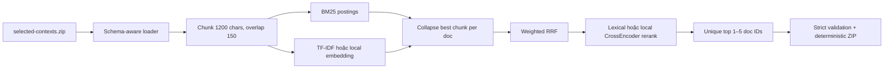
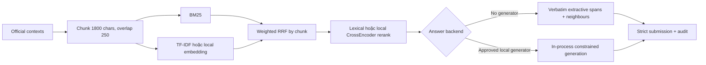

# Public-test handoff — UIT DSC 2026 LegalIR & LegalQA

> Cập nhật 06/08/2026: Task 1 official public data đã được audit, index và infer đủ 1.000 câu. Thuật toán SQLite FTS5, kết quả holdout, lệnh tái tạo và 5 ZIP hợp lệ nằm trong [`Task1 - LegalIR/PUBLIC_TEST_RUNBOOK.md`](Task1%20-%20LegalIR/PUBLIC_TEST_RUNBOOK.md). Phần Task 1 cũ phía dưới chỉ còn giá trị lịch sử thiết kế trước khi BTC phát corpus.

Tài liệu này mô tả trạng thái code sau đợt sửa ngày 05/08/2026, thuật toán, flow chạy và checklist để teammate tiếp quản. Code trong repo này độc lập hoàn toàn với `D:\projects\Viettel AI race\viettel 2.0`: không import, không đọc file runtime và không phụ thuộc đường dẫn của repo Viettel.

## 1. Trạng thái hiện tại

- Hai submission warmup đều đúng schema, ZIP chỉ chứa đúng `submission.json` ở root.
- Task 1 warmup chấm theo scorer BTC: precision `1.0`, recall `1.0`.
- Task 2 warmup: ROUGE-L `1.0`, METEOR `0.9999998978316378`.
- Đã smoke-test end-to-end trên corpus giả lập đúng schema BTC, gồm `id` dạng số.
- Chưa thể đo chất lượng retrieval/generation public test vì BTC chưa cung cấp `selected-contexts.zip` và `public-official.json` thật.
- Không có API, HTTP client hay tự tải model. Model neural chỉ được load từ thư mục local và phải qua model registry.

## 2. Contract BTC đã khóa trong code

Corpus chính thức có thể là ZIP gồm nhiều `context_*.json`:

```json
{
  "id": 740,
  "name": "Tên văn bản",
  "link": "...",
  "passage": "Nội dung pháp luật..."
}
```

Public input:

```json
{
  "question_id": {
    "question": "Câu hỏi..."
  }
}
```

Task 1 output:

```json
{
  "question_id": {
    "answer": ["740"]
  }
}
```

Task 2 output:

```json
{
  "question_id": {
    "answer": "Câu trả lời không rỗng..."
  }
}
```

Các invariant trước khi upload:

1. Tập question ID phải bằng chính xác tập ID trong public input.
2. Task 1 trả 1–5 document ID dạng string, không duplicate.
3. Task 2 trả string không rỗng.
4. ZIP chỉ có một file tên chính xác `submission.json` ở root.
5. Task 1 scorer không quan tâm thứ hạng trong top-5 nhưng duplicate làm giảm precision.
6. Task 2 scorer dùng METEOR trên `str.split()`; ROUGE tokenizer BTC chỉ giữ `[a-z0-9]`. Không dùng tokenizer tiếng Việt để giả lập ROUGE của BTC.

## 3. Flow Task 1 — LegalIR



### Thuật toán

- Loader đọc ZIP/directory/JSON/TXT, lấy `passage`, đổi mọi document ID sang string và dừng nếu duplicate ID có nội dung xung đột.
- Văn bản dài được chunk theo biên newline/space. Mỗi chunk giữ `doc_id` gốc và có `chunk_id` riêng.
- Sparse retrieval dùng BM25 với inverted postings; query time chỉ duyệt postings của term xuất hiện trong query.
- Semantic view mặc định là TF-IDF L2-normalized, giúp baseline chạy không model. Khi cung cấp local embedding đã duyệt, view này đổi sang SentenceTransformer.
- Trước RRF, mỗi retriever chỉ giữ chunk tốt nhất của từng document. Việc này ngăn một văn bản dài chiếm nhiều vị trí top-5.
- RRF hợp nhất rank thay vì cộng raw score khác thang đo.
- Reranker mặc định dùng token recall + exact legal reference. Có thể thay bằng local CrossEncoder đã duyệt.
- Nếu query hoàn toàn OOV, pipeline vẫn tạo output hợp lệ và ghi `zero_score_fallback=true` trong metadata; đây là cảnh báo cần audit, không được xem như retrieval thành công.

### Lệnh chạy

```powershell
cd "D:\projects\UIT DSC\Task1 - LegalIR"
python scripts\main.py train --corpus "D:\data\selected-contexts.zip"
python scripts\main.py infer --input "D:\data\public-official.json" --output output\submission.zip
python scripts\main.py eval --predictions output\submission.zip --references warmup.json
```

Nếu muốn build index và infer trong một lệnh, thêm `--corpus` vào lệnh `infer`.

### Lưu ý về corpus lấy trên mạng

Nội dung pháp luật online có thể dùng để nghiên cứu offline nếu thể lệ dữ liệu cho phép, nhưng không thể tự suy ra ID của BTC. Task 1 chỉ được chấm trên ID BTC, vì vậy phải join nội dung online với `selected-contexts` bằng metadata/text fingerprint sau khi corpus chính thức được phát. Không output URL, số hiệu luật hoặc ID tự tạo thay cho ID BTC.

## 4. Flow Task 2 — LegalQA



### Baseline extractive

1. Retrieve top chunks bằng BM25 + TF-IDF.
2. RRF và rerank candidate.
3. Chấm câu theo query-token recall, exact `Điều/Khoản/Điểm/Chương` và chunk rank.
4. Lấy seed độ tin cậy cao, mở rộng một câu trước/sau để giữ điều kiện và ngoại lệ.
5. Khử câu trùng nhưng giữ nguyên câu nguồn; không tự thêm citation vì text thừa có thể giảm METEOR/ROUGE.
6. Giới hạn mặc định 8.000 ký tự, phù hợp phân bố warmup có answer dài tới khoảng 8.089 ký tự.

### Local generator tùy chọn

- Chạy trực tiếp bằng `transformers`, không start server và không gọi localhost/API.
- Prompt buộc chỉ dùng retrieved context, giữ số điều/khoản, điều kiện và ngoại lệ.
- `do_sample=False`; với Qwen3 code thử tắt thinking.
- Tokenizer truncation từ trái để giữ phần câu hỏi ở cuối prompt khi context quá dài.
- Generator rỗng làm pipeline fail-fast.

### Lệnh baseline

```powershell
cd "D:\projects\UIT DSC\Task2 - LegalQA"
python scripts\main.py `
  --corpus "D:\data\selected-contexts.zip" `
  --input "D:\data\public-official.json" `
  --output output\submission.zip
```

Lệnh sinh thêm `output/inference_audit.json`, trong đó có latency, backend, chunk/doc được chọn và fallback flag của từng query.

## 5. Model registry — teammate phải làm gì?

Baseline không-model chạy mà không cần registry. Khi bật bất kỳ neural model nào:

1. Teammate hỏi team lead/chủ tài khoản đăng ký model (hiện là bạn) để xác nhận BTC đã duyệt.
2. Copy `models/approved_models.example.json` thành một file registry thật, ví dụ `models/approved_models.local.json`.
3. Điền model ID, component, local path, số tham số, license và bằng chứng phê duyệt.
4. Chỉ đặt cả `registered` và `btc_approved` thành `true` sau khi đã có xác nhận thực tế.
5. Mọi weight phải được tải sẵn. Runtime không download.
6. Code cộng số tham số theo model ID duy nhất và yêu cầu tổng **nhỏ hơn** 4.000.000.000. Quantization không làm giảm parameter count để xét luật.

Ví dụ chạy neural sau khi được duyệt:

```powershell
python scripts\main.py `
  --corpus "D:\data\selected-contexts.zip" `
  --input "D:\data\public-official.json" `
  --embedding-model "D:\models\bge-m3" `
  --reranker-model "D:\models\bge-reranker-v2-m3" `
  --generator-model "D:\models\qwen" `
  --model-registry "D:\projects\UIT DSC\models\approved_models.local.json"
```

Nếu thiếu một trường hoặc model chưa được BTC duyệt, chương trình dừng. Không thêm `--force`, không sửa firewall chỉ để chạy thử.

## 6. Hướng thử multi-model cho Task 2

Đây là shortlist nghiên cứu, **không phải danh sách đã được BTC duyệt**.

| Hướng | Thành phần | Tổng tham số xấp xỉ | Mục tiêu |
|---|---|---:|---|
| A — baseline | BM25 + TF-IDF + lexical rerank + extractive | 0 | Có mốc chạy chắc chắn, audit retrieval |
| B — quality RAG | BGE-M3 0.6B + BGE reranker v2-m3 0.6B + Qwen2.5-1.5B 1.54B | 2.74B | Cân bằng retrieval dài, rerank và answer tiếng Việt |
| C — Qwen3 | BGE-M3 0.6B + BGE reranker 0.6B + Qwen3-1.7B 1.7B | 2.90B | So sánh instruction following/non-thinking |
| D — lean | multilingual-E5-small 0.1B + gte multilingual reranker 0.306B + Qwen2.5-1.5B 1.54B | 1.946B | Nhanh, chừa ngân sách cho fine-tune/ensemble |
| E — 2 generators | BGE-M3 0.6B + BGE reranker 0.6B + Qwen2.5 0.49B + Qwen2.5 1.54B | 3.23B | Một model extract/plan, một model answer/verify |

Nguồn model card để team kiểm tra trước khi đăng ký:

- BGE-M3: MIT, multilingual, dense+sparse+multi-vector, context tới 8192 — https://huggingface.co/BAAI/bge-m3
- BGE reranker v2-m3: Apache-2.0, multilingual, khoảng 0.6B — https://huggingface.co/BAAI/bge-reranker-v2-m3
- multilingual-E5-small: MIT, khoảng 0.1B; cần prefix `query:`/`passage:` — https://huggingface.co/intfloat/multilingual-e5-small
- gte multilingual reranker: Apache-2.0, 306M, hơn 70 ngôn ngữ — https://huggingface.co/Alibaba-NLP/gte-multilingual-reranker-base
- Qwen2.5-1.5B-Instruct: Apache-2.0, 1.54B, model card nêu hỗ trợ tiếng Việt — https://huggingface.co/Qwen/Qwen2.5-1.5B-Instruct
- Qwen2.5-0.5B-Instruct: Apache-2.0, 0.49B — https://huggingface.co/Qwen/Qwen2.5-0.5B-Instruct
- Qwen3-1.7B: Apache-2.0, 1.7B, 100+ ngôn ngữ/phương ngữ — https://huggingface.co/Qwen/Qwen3-1.7B

Hướng B nên được thử trước sau baseline. Hướng E cần bổ sung orchestration hai generator; code hiện chỉ nhận một generator. Hướng D cần adapter thêm prefix E5 và review local custom code nếu dùng GTE embedding/reranker. Không bật `trust_remote_code` một cách tự động.

### Ablation tối thiểu

Giữ nguyên split câu hỏi và thay đúng một thành phần mỗi lần:

1. BM25 only: `--semantic-weight 0`.
2. BM25 + TF-IDF mặc định.
3. BM25 + approved embedding.
4. Bước 3 + approved reranker.
5. Bước 4 + extractive answer.
6. Bước 4 + local generator.
7. Thử `answer_chunks` trong `{3, 5, 8}` và chunk size trong `{1200, 1800, 2400}`.

Ghi METEOR, ROUGE-L, retrieval recall nếu có label document, latency, peak VRAM và tỷ lệ `zero_score_fallback`. Chỉ nhận thay đổi nếu pseudo-dev cải thiện; không tune trực tiếp trên public leaderboard nhiều lần.

## 7. Ý tưởng tham khảo từ pipeline Viettel đã chuyển sang

Chỉ chuyển nguyên tắc, không chuyển code/dữ liệu y tế:

- Backbone đơn giản và ổn định trước, model chỉ là overlay.
- Candidate generation nhiều tầng và fusion thay vì tin một retriever.
- Precision gate: chỉ đổi/generate khi có context evidence.
- Không silent fallback; fallback phải hiện trong audit.
- Dry-run/audit, regression test và ablation trước khi gọi một phiên bản là tốt hơn.
- Model load một lần, inference theo batch; không reload theo file/query.
- Mutation/output firewall: exact ID set, schema, parameter/license/approval.

## 8. Tests và validation

Install baseline:

```powershell
python -m pip install -r requirements-core.txt
```

Neural optional:

```powershell
python -m pip install -r requirements-neural.txt
```

Evaluator Task 2:

```powershell
python -m pip install -r requirements-eval.txt
```

Chạy test:

```powershell
python -m unittest discover -s tests -v
python scripts\verify_submissions.py
python scripts\official_round_analyzer.py --mode compare --task 1
python scripts\official_round_analyzer.py --mode compare --task 2
```

Phân tích corpus ngay sau khi BTC phát:

```powershell
python scripts\corpus_analyzer.py `
  --corpus "D:\data\selected-contexts.zip" `
  --export reports\corpus_summary.json
```

## 9. Checklist trước public submit

- [ ] Hash và backup nguyên bản corpus/input BTC.
- [ ] Chạy `corpus_analyzer.py`, kiểm tra duplicate/conflicting ID/very-short context.
- [ ] Xác nhận model với team lead và BTC; cập nhật registry, license, parameter count.
- [ ] Chạy ít nhất baseline và một ablation neural trên pseudo-dev.
- [ ] Kiểm tra audit không có tỷ lệ fallback bất thường.
- [ ] Chạy scorer parity local.
- [ ] Chạy `verify_submissions.py` với đúng public input.
- [ ] Mở ZIP kiểm tra chỉ có root `submission.json`.
- [ ] Lưu config, registry, model revision/hash và inference audit cùng submission.

## 10. File chính

- `Task1 - LegalIR/scripts/corpus_loader.py`: loader + chunk Task 1.
- `Task1 - LegalIR/scripts/pipeline.py`: BM25/semantic/RRF/rerank/doc collapse.
- `Task1 - LegalIR/scripts/main.py`: CLI Task 1.
- `Task2 - LegalQA/scripts/corpus_loader.py`: loader độc lập Task 2.
- `Task2 - LegalQA/scripts/task2_pipeline.py`: retrieval + answer backend.
- `Task2 - LegalQA/scripts/main.py`: CLI Task 2 + inference audit.
- `scripts/model_policy.py`: approval/license/parameter firewall.
- `scripts/submission_utils.py`: strict submission contract.
- `scripts/verify_submissions.py`: pre-upload validator.
- `scripts/corpus_analyzer.py`: official corpus audit.
- `tests/`: scorer/contract và end-to-end smoke tests.

Khi sửa thuật toán hoặc flow sau này, cập nhật file này trong cùng commit để teammate không phải suy ngược từ code.
