# Task 1 — Legal Information Retrieval

> Tài liệu đầy đủ: đề thi, flow production (`sqlite_chunk_fts5_v5_document_phrase_rrf`), toàn bộ thử nghiệm đã chạy (đã thành công / đã loại) và các hướng cải tiến tiếp theo.
>
> Submission hiện hành: `final_submission_recall_v3/submission.zip`, điểm public **Recall 0.8135**, Precision 0.1648 → Top 6 trên UIT-DSC leaderboard.

---

## Mục lục

1. Đề thi (`DSC2026_Task1_LegalIR_Data_Overview.docx`)
2. Cấu trúc thư mục
3. Flow tổng thể
4. Backend SQLite FTS5 — thuật toán production
5. Lệnh chạy
6. Kết quả đo & submission
7. Tất cả thử nghiệm đã làm và kết luận
8. Hướng cải tiến tiếp theo (ưu tiên)
9. Checklist trước upload

---

## 1. Đề thi

| Hạng mục | Giá trị |
|---|---|
| Input | Một câu hỏi tiếng Việt cần tra cứu văn bản pháp luật. |
| Output | Danh sách 1–5 `document_id` (chuỗi) cho mỗi câu hỏi. |
| Độ đo chính | **Recall** (trung bình cộng trên tất cả câu hỏi). |
| Độ đo phụ | **Precision** (chỉ tie-break khi cùng Recall). |
| File dữ liệu | `train.json`, `warmup.json`, `public-official.json`, `private-official.json`, `selected-contexts.zip` (nhiều `context_*.json`). |
| Một `context_*.json` | `{ id, name, link, passage }`. BTC chấm đúng ID này. |
| Submission | Một `submission.zip` chỉ chứa duy nhất `submission.json` ở root, dạng `{question_id: {"answer": ["id1","id2",…]}}`. |

Công thức Recall / Precision được tái hiện chính xác trong `scripts/evaluate.py::official_metrics` (bit-for-bit với `Scoring-Program-Task-LegalIR/scoring.py`). Nếu `answer` rỗng hay dài quá 5 thì precision = 0 và recall = 0 cho câu đó.

---

## 2. Cấu trúc thư mục Task 1

```
Task1 - LegalIR/
├── README.md                       # File này
├── scripts/
│   ├── main.py                     # CLI: train / infer / eval / analyze / variants
│   ├── sqlite_retriever.py         # Backend FTS5 production
│   ├── pipeline.py                 # HybridRetriever (BM25 + dense + rerank) — thử nghiệm
│   ├── corpus_loader.py            # Loader + chunker cho hybrid backend
│   ├── bm25_retriever.py           # BM25 postings + tokenize tiếng Việt
│   ├── dense_retriever.py          # TF-IDF fallback / SentenceTransformer
│   ├── reranker.py                 # Lexical reranker + CrossEncoder wrapper
│   ├── retrieval_types.py          # QueryResult/RetrievalResult dataclass
│   ├── evaluate.py                 # Scorer parity + LegalIREvaluator + checkpoint
│   ├── audit_public_data.py        # Audit toàn bộ corpus BTC
│   └── benchmark_*.py              # Tất cả ablation thử nghiệm (xem mục 7)
├── data/
│   ├── raw/public_test/            # Corpus BTC chính thức (giữ nguyên, không push)
│   └── processed/                  # Index tái tạo được (đã .gitignore)
├── output/                         # Submission zip + sidecar json
├── final_submission_recall_v3/     # ZIP đã upload (Recall = 0.8135)
├── reports/                        # Audit inference v3 + data audit
├── Scoring-Program-Task-LegalIR/   # Scorer BTC nguyên bản (so sánh parity)
├── warmup.json                     # Tập warmup để smoke-test
└── DSC2026_Task1_LegalIR_Data_Overview.docx
```

---

## 3. Flow tổng thể

```mermaid
flowchart LR
    A[selected-contexts.zip + train.json] --> B[audit_public_data.py]
    B --> C[main.py train]
    C -->|stream từng context| D[SQLite FTS5 chunks + aliases + question_memory]
    D --> E[main.py infer]
    E --> F[retrieve query]
    F --> G[exact_memory → focused FTS → alias FTS → train question KNN → char n-gram Jaccard → OR-BM25 → document phrase FTS]
    G --> H[RRF fusion theo doc_id]
    H --> I[recall fill nếu thiếu]
    I --> J[Submission zip + audit json]
    J --> K[verify_submissions.py]
    K --> L[upload]
```



Toàn bộ pipeline chạy offline, không gọi API, không tải model. Mọi model neural (embedding / reranker) chỉ chạy khi BTC duyệt và model đã ở local path; `scripts/model_policy.py` enforce điều này.

---

## 4. Backend SQLite FTS5 — thuật toán production

File chính: `scripts/sqlite_retriever.py` (backend `sqlite_chunk_fts5_v5_document_phrase_rrf`).

### 4.1. Build index

`SQLiteFTSRetriever.build()`:

1. **Stream corpus** từ ZIP qua `iter_contexts()` — không giữ toàn bộ passage trong RAM.
2. **Sinh surrogate text** cho 20 passage rỗng (lấy `name` hoặc slug URL).
3. **Chunk** theo biên newline/space (mặc định **1400 ký tự, overlap 200**). Logic ở `iter_text_chunks()`.
4. **Tạo 3 FTS5 tables**:
   - `chunks(doc_id, chunk_id, title, passage)` — đánh index full passage.
   - `aliases(doc_id, alias_text)` — gom mọi câu hỏi train trỏ tới cùng `doc_id`.
   - `question_examples(question_id, answers, question)` — bản sao bảng train để tra cứu KNN.
5. **Bảng phụ**: `document_meta`, `document_prior` (label count), `question_memory` (exact normalized match), `term_stats` (document frequency).
6. **Tối ưu** index bằng `INSERT INTO chunks(chunks) VALUES ('optimize')` rồi drop `chunk_vocab` tạm.

Sau build:
- 8.532 documents → 294.731 chunks.
- Index SQLite khoảng 1,27 GB (artifact tái tạo được, đã `.gitignore`).
- 20 passage rỗng được giữ ID bằng surrogate.
- 4 nhóm passage trùng hoàn toàn (không ảnh hưởng retrieval).

### 4.2. Retrieve — 7 nhánh tín hiệu, gộp bằng RRF

Với mỗi câu hỏi, 7 nhánh chạy tuần tự và gộp bằng RRF:

| Bước | Nhánh | Logic chính |
|---|---|---|
| 1 | `preprocess` | `expand_query` nếu bật; `VietnameseTokenizer` (unigram). |
| 2 | `exact_memory` | Tra `question_memory` theo normalized question. Nếu khớp → trả ID trực tiếp, bypass phần còn lại. |
| 3 | `chunk_focused` | `_match_expression` lấy `max_query_terms` (12) token hiếm nhất qua `term_stats`. `_focused_expressions` sinh các biểu thức FTS5 AND 3/4 token hiếm. |
| 4 | `chunk_broad_fallback` | Nếu `<10` candidates → AND 2 token (anchor = token hiếm nhất). |
| 5 | `alias_fusion` | FTS5 trên `aliases` với cùng expression, weight = `alias_weight / (60+rank)`. |
| 6 | `question_KNN` | FTS5 trên `question_examples` lấy câu hỏi train gần nhất, weight = `question_weight / (20+rank)`. |
| 7 | `char_ngram` | Jaccard 3/4-gram đã gỡ dấu tiếng Việt giữa query và tất cả câu hỏi train. |
| 8 | `or_bm25` | OR-BM25 tối đa 12 token, 400 chunk, BM25 weight `title=3, passage=1`. |
| 9 | `document_phrase` (tuỳ chọn) | Bigram cạnh nhau trong câu hỏi, tra trên DB FTS5 riêng (`document_fts_v3.sqlite3`), `title=3, passage=1`. |
| 10 | `RRF` | Base weight 3.0, OR weight 7.0, RRF-k=20. |
| 11 | `document_phrase_fusion` | RRF phụ (base=1.0, phrase=0.25, k=0) — chỉ chạy khi bật `--document-fts-db`. |
| 12 | `exact_memory_override` | Nếu có exact match, đẩy các ID đó lên đầu với score 1e6. |
| 13 | `recall_fill` | Nếu thiếu `<top_k` ID, lấy thêm từ `document_prior` (label count). |
| 14 | `submission write` | `_write_bundle` ghi `submission.json` (UTF-8) vào ZIP, sidecar JSON. |
| 15 | `audit` | `audit_output` ghi `audit.json` với latency, method distribution, fallback. |

### 4.3. Cấu hình mặc định đã validate

| Param | Mặc định | Vai trò |
|---|---:|---|
| chunk_size / overlap | 1400 / 200 | Tradeoff precision/recall chunk. |
| max_query_terms | 12 | Số token hiếm nhất dùng cho focused query. |
| or_query_terms / or_chunk_limit | 12 / 400 | Ngân sách OR-BM25. |
| base_fusion_weight / or_fusion_weight | 3.0 / 7.0 | Tỉ lệ RRF giữa focused và OR. |
| retrieval_rrf_k | 20 | Hằng số RRF. |
| title_weight / passage_weight | 3.0 / 1.0 | BM25 weights trong FTS5. |
| alias_weight | 2.0 | Trọng số alias FTS. |
| question_weight | 4.0 | Trọng số câu hỏi train gần nhất. |
| document_phrase base / phrase | 1.0 / 0.25, k=0 | RRF phụ (chỉ chạy khi bật `--document-fts-db`). |

### 4.4. Checkpoint & resume

`evaluate.py::LegalIREvaluator.run_inference` ghi checkpoint atomic mỗi `checkpoint_every` query (mặc định 10). Signature gồm SHA-256 input, top_k, và metadata index (path, size, mtime, backend + document FTS). `--resume` chỉ chấp nhận nếu tất cả trùng.

### 4.5. Hợp đồng submission

- ZIP **chỉ** chứa `submission.json` ở root; `_write_bundle` ép đúng schema.
- Mỗi câu hỏi **bắt buộc** 1–5 ID, dạng string, không trùng. `main.py` raise nếu vi phạm.
- Tập `question_id` của output phải bằng đúng tập của input.
- Nếu OOV (zero candidate), pipeline sinh fallback **không rỗng** nhưng ghi `zero_score_fallback=true` trong audit — BTC vẫn chấm 0 ở câu đó.
- Model neural chỉ chạy qua `scripts/model_policy.py::validate_model_plan`; tổng parameter < 4B, license & BTC_approved đều bắt buộc.

---

## 5. Lệnh chạy

### 5.1. Audit dữ liệu BTC

```powershell
cd "D:\projects\UIT DSC"
python "Task1 - LegalIR\scripts\audit_public_data.py"
```

In ra: số context, duplicate, passage rỗng, schema lỗi, CRC/SHA-256. Xuất `reports/public_data_audit.json`.

Kết quả BTC:

| Hạng mục | Giá trị |
|---|---:|
| Câu train có nhãn | 7.000 |
| Câu public (`answer: null`) | 1.000 |
| Context trong ZIP | 8.532 |
| File context đã giải nén | 8.532 |
| Context thiếu so với nhãn train | 0 |
| File giải nén lệch byte so với ZIP | 0 |
| Lỗi schema | 0 |
| Passage rỗng | 20 |
| Nhóm passage trùng hoàn toàn | 4 |

`name` là field tùy chọn: 1.125 context chính thức không có field này. Hai mươi passage rỗng vẫn được giữ ID; index dùng `name`/slug của `link` làm surrogate text.

### 5.2. Build index

```powershell
python "Task1 - LegalIR\scripts\main.py" train `
  --backend sqlite `
  --corpus "Task1 - LegalIR\data\raw\public_test\selected-contexts.zip" `
  --train-data "Task1 - LegalIR\data\raw\public_test\train.json" `
  --index-dir "Task1 - LegalIR\data\processed\public_index" `
  --chunk-size 1400 `
  --chunk-overlap 200 `
  --candidates 40
```

Index production khoảng 1.27 GB, build ~76 giây. Artifact đã `.gitignore`.

### 5.3. Infer public

```powershell
python "Task1 - LegalIR\scripts\main.py" infer `
  --index-dir "Task1 - LegalIR\data\processed\public_index" `
  --input "Task1 - LegalIR\data\raw\public_test\public-official.json" `
  --output "Task1 - LegalIR\output\public_submission_top5.zip" `
  --audit-output "Task1 - LegalIR\reports\public_inference_audit.json" `
  --checkpoint-output "Task1 - LegalIR\reports\public_inference_recall_v3.checkpoint.json" `
  --checkpoint-every 10 `
  --top-k 5
```

Muốn bật v3 phrase FTS thì thêm:

```powershell
--document-fts-db "Task1 - LegalIR\data\processed\document_fts_v3.sqlite3"
```

Nếu máy dừng giữa chừng, chạy lại đúng lệnh và thêm `--resume`. Không đổi input, index, document DB hoặc top-k trong lúc resume.

### 5.4. Sinh variants top-1 → top-5

```powershell
python "Task1 - LegalIR\scripts\main.py" variants `
  --predictions "Task1 - LegalIR\output\public_submission_top5.zip" `
  --output-dir "Task1 - LegalIR\output" `
  --prefix public_submission
```

### 5.5. Validate trước upload

```powershell
python "scripts\verify_submissions.py" `
  --task 1 `
  --task1-submission "Task1 - LegalIR\output\public_submission_top5.zip" `
  --task1-input "Task1 - LegalIR\data\raw\public_test\public-official.json"
```

### 5.6. Đánh giá trên warmup

```powershell
python "Task1 - LegalIR\scripts\main.py" eval `
  --predictions "Task1 - LegalIR\output\public_submission_top5.zip" `
  --references "Task1 - LegalIR\warmup.json" `
  --all-top-k
```

---

## 6. Kết quả đo & submission

### 6.1. Các submission đã sinh

| Phiên bản | Holdout (P / R) | Public (P / R) | Trạng thái |
|---|---|---|---|
| Baseline FTS (không alias) | 0.078 / 0.357 (P@5/R@5) | — | Lịch sử |
| FTS + train alias (v1) | 0.081 / 0.370 (P@5/R@5) | — | Lịch sử |
| Top-1 đã upload | — | **0.239 / 0.2308** | Đã upload |
| Top-5 đã upload | — | **0.1001 / 0.451** | Đã upload |
| `final_submission_recall_v2` | 0.180 / 0.7917 (holdout 100) | **0.1648 / 0.7694** | Đã upload |
| `final_submission_recall_v3` (candidate) | 0.184 / 0.8117 (holdout 100) | **0.1648 / 0.8135** | **Đang giữ** (Top 6 leaderboard) |

### 6.2. Số liệu infer public của v3

| Chỉ số | Giá trị |
|---|---:|
| Public questions | 1.000/1.000 |
| Tổng predictions | 5.000 |
| Câu có đúng 5 ID | 1.000 |
| Tổng inference time | 4.703,8 giây |
| Mean latency | 4,699 giây/câu |
| Max latency | 9,0075 giây |
| Exact train-question match | 5 |
| Zero-score fallback | 0 |
| ID ngoài corpus | 0 |
| Duplicate ID trong một câu | 0 |
| SHA-256 v3 | `d018076d4b61aa772e5c125d488652513d591c4bdf11327356c5e38ff9b0ea5b` |

---

## 7. Tất cả thử nghiệm đã làm và kết luận

### 7.1. Pipeline tổng thể qua các vòng

```text
v1: BM25 only (corpus only)
v2: + train alias + nearest question KNN + char n-gram Jaccard
v2 recall_v2: + OR-BM25 12 terms fusion 3:7, k=20, checkpoint/resume
v3 candidate: + document-level FTS phrase, weight 0.25, k=0
```

### 7.2. Holdout không rò nhãn — tiến hoá Recall

| Cấu hình | P@1 | R@1 | P@2 | R@2 | P@5 | R@5 |
|---|---:|---:|---:|---:|---:|---:|
| Corpus only | 0.168 | 0.163 | 0.126 | 0.236 | 0.0776 | 0.357 |
| Corpus + 80% train aliases | **0.212** | **0.203** | **0.144** | **0.267** | **0.0813** | **0.370** |

Holdout 250 câu; 80% train còn lại tạo aliases. Scorer parity với BTC.

### 7.3. Bảng Recall optimization sau lượt leaderboard đầu (100 câu holdout, leak-free)

| Pipeline | Precision | Recall |
|---|---:|---:|
| Supervised + character (cũ) | 0.114 | 0.4958 |
| OR-BM25 8 term | 0.136 | 0.6025 |
| Fusion 8 term, RRF 4:7, k=20 | 0.174 | 0.7633 |
| OR-BM25 12 term | 0.152 | 0.6808 |
| **Fusion 12 term, RRF 3:7, k=20** | **0.180** | **0.7917** |

Fusion 12 term đạt candidate recall@40 `0.8817`. Trước lượt public tiếp theo phải thêm checkpoint/resume định kỳ — đã làm.

### 7.4. Document-level FTS v3 (chi tiết)

Database riêng `data/processed/document_fts_v3.sqlite3` (cỡ 796 MB) gồm **đúng 8.532 rows**, mỗi văn bản BTC là một FTS row chứa `title + passage`. Metadata `complete=1`.

Token hóa: unigram Unicode giữ thứ tự; tạo bigram cạnh nhau tối đa 16 phrase; truy vấn FTS5 `"term1 term2" OR ...`; BM25 `title=3, passage=1`, lấy tối đa 80 docs.

**Early-stop 40 câu:**

| Phương án | Precision@5 | Recall@5 | Candidate recall@40 |
|---|---:|---:|---:|
| v2 base | 0.2000 | 0.8792 | 0.9167 |
| document exact phrase direct | 0.1750 | 0.7625 | 0.8792 |
| v2 + rare12/phrase, weight 0.25, k=60 | **0.2050** | **0.8917** | 0.9167 |

Union coverage `v2 top40 ∪ phrase top40` = `0.9417` (+0.025 vs v2). Tín hiệu dương nhưng 40 câu chưa đủ chắc.

**Confirm 100 câu (chạy tiếp):**

| Cấu hình | Recall@5 | Precision@5 |
|---|---:|---:|
| v2 baseline trên 100 câu | 0.7917 | 0.180 |
| doc_phrase direct, w=0.6, k=0 | 0.8200 | 0.188 |
| **doc_phrase + v2 RRF, w=0.25, k=0 (khuyến nghị)** | **0.8117** | **0.184** |
| doc_phrase direct best | 0.7558 | 0.170 |

`w=0.25, k=0` được chọn vì không regression tuning50 và cải thiện validation50 Recall `0.710 → 0.750`, Precision `0.160 → 0.168`. Production `w=0.6` tăng cao hơn trên full 100 (+0.028 R) nhưng giảm tuning50 → chọn an toàn.

### 7.5. Ablation đã chạy và bị loại

| Thử nghiệm | File | Kết luận |
|---|---|---|
| Legal phrase/title/reference | `benchmark_v3_legal_agent.py` | Đã dừng ở 90/100. Không cấu hình nào tăng R trên 50 tuning; title weight 2/3/5 làm giảm Recall `0.65 → 0.60` trên validation. **Loại**. |
| OR BM25 term-count/depth (12/16/20/24/all) | `benchmark_v3_or_depth_agent.py` | Tốt nhất `terms20/rows400/docs40/OR weight 7:3/k=30`: Recall `0.7967` trên 100 câu. Gain chỉ đến từ 1 câu. **Loại, không robust**. |
| TF-IDF supervised (word / char / hybrid) | `benchmark_v3_tfidf_agent.py` | Tốt nhất 5-fold Recall `0.518` (word 1–2 gram). Hợp với v2 candidate@40 chỉ `0.885`, grid 63 RRF không tăng top-5 v2. **Loại**. |
| Document family / co-label / series title | `benchmark_v3_family_agent.py` | Tốt nhất `series_title_w0.20` delta `+0.000702`. Dưới ngưỡng +0.005, giảm ở fold 0. **Loại**. |
| Co-label graph đồng nhãn (46 biến thể) | `benchmark_v3_family_agent.py` | Cùng nhận định: 6.447/7.000 câu chỉ 1 đáp án, độ lệch fold làm mất lợi ích. **Loại**. |
| Global title / số hiệu pháp lý | (trong `benchmark_v3_legal_agent.py`) | Standalone Recall `0.0504`; chỉ 30/7.000 câu có số hiệu rõ. **Loại**. |
| Fine sweep RRF (focused/OR) | (nội bộ pipeline) | Cấu hình v2 `3:7, k=20` vẫn tốt nhất; adaptive rule +0.005 trên 1 fold → overfit. **Giữ v2**. |
| Supervised question/alias full 5-fold | (trong `benchmark_v3_*`) | 5-fold tốt nhất R `0.5017`; fuse vào v2 giảm `0.7917 → 0.7767`. **Loại**. |

### 7.6. Tóm tắt ablation v3 đã chạy

| Hướng đã thử | Kết quả | Quyết định |
|---|---|---|
| Legal phrase / title / synonym / exact reference | Tuning 50 câu Recall 0.7741; không cấu hình nào tăng | BỎ |
| OR-BM25 term-count 12/16/20/24 | Best tăng +0.005 R nhưng chỉ 1 câu | BỎ |
| TF-IDF word/char supervised | 5-fold R 0.518; fuse không tăng top-5 v2 | BỎ |
| Co-label / document family / series title | Tốt nhất +0.0007 R | BỎ |
| Document-level FTS phrase (w=0.25, k=0) | Tăng +0.020 R full100, +0.040 trên validation50 | **GIỮ + TÍCH HỢP v3** |
| Local cross-encoder rerank (chưa duyệt) | Chưa bật (BTC chưa duyệt) | DEFER |

### 7.7. Bài học rút ra

1. **Mọi tín hiệu supervised (full train)** đều kéo v2 xuống → chỉ giữ khi chạy trên 80% train và đánh giá trên 20% còn lại.
2. **Tín hiệu lexical pháp lý (title/số hiệu)** quá thưa — chỉ 30/7.000 câu có số hiệu rõ, không đủ để fuse toàn cục.
3. **OR-BM25 với term-count cao** chỉ thắng nhờ 1 câu → dấu hiệu overfit fold.
4. **Document phrase FTS** là tín hiệu duy nhất có delta dương trên cả tuning & validation, và gain tăng đều khi mở rộng từ 40 → 100 câu → mới promote được.
5. **Safety-first fusion weight**: w=0.25 (bảo thủ) được ưu tiên hơn w=0.6 (cao hơn full100) vì tăng đều ở cả 2 nửa holdout.

---

## 8. Hướng cải tiến tiếp theo

Sắp xếp theo gain tiềm năng dựa trên holdout + public + gap với top 1 (UIT-YQueFue36, R=0.9387, cách bạn 0.125).

### 8.1. Mở rộng recall bằng n-gram mức chunk (HIGH)

Hiện phrase FTS chỉ chạy ở document level. Thử bigram/trigram trên `chunks` table sẽ bắt được paraphrase có bigram trùng (ví dụ "căn cứ pháp lý", "hợp đồng lao động").

- Tái dùng `_focused_expressions` nhưng thay token bằng `token1 token2`;
- BM25 weights: title=3, passage=1;
- Benchmark trên holdout 100 câu đã có sẵn.
- Kỳ vọng: recall@40 có thể vượt `0.94` hiện tại.

### 8.2. Tăng OR coverage nhưng kiểm soát latency (HIGH)

- Tăng `or_chunk_limit` từ 400 → 800, dùng 24 token hiếm;
- Tăng `or_fusion_weight` lên 8.0 (OR đóng vai trò recall chính);
- Tận dụng checkpoint 10 câu đã có sẵn để chạy full 1.000 câu an toàn;
- Đo latency trade-off; không vượt 6s/câu để leaderboard không timeout.

### 8.3. Học trọng số fusion trên holdout không rò nhãn (MEDIUM)

Hiện weight do tay chỉnh. Fit log-linear trên 100 câu holdout (đã có `reports/v3_document_fts_agent_100.json`):

- Tìm `(base, or, phrase, k)` tối ưu Recall+F1.
- Tránh overfit: chỉ promote nếu validation50 cũng tăng ≥ +0.005.
- Có thể grid search Python thuần; không cần model.

### 8.4. Bổ sung cross-encoder rerank local (MEDIUM → HIGH nếu BTC duyệt)

- Adapter đã có sẵn ở `scripts/reranker.py::Reranker`.
- Khi BTC duyệt reranker model, bật rerank trên top 20 candidate fused.
- Đây là cách tăng Precision đáng kể mà không giảm Recall.

### 8.5. Cải thiện exact_memory và alias (MEDIUM)

- Loại stopword (`là`, `của`, `được`, `theo`...) khỏi alias_text.
- Thêm stemming đơn giản để alias bắt được paraphrase.
- Đo trên holdout 100 — chỉ promote nếu R tăng đều cả 2 nửa.

### 8.6. Cache prebuilt chunk candidates (LOW effort)

Với 1.000 câu hỏi, mỗi lần infer vẫn chạy lại toàn bộ FTS5 query. Cache `_chunk_candidates` (và OR-BM25) theo `hash(query)` vào file JSON. Chỉ chạy lại khi signature đổi. Tiết kiệm ~30% thời gian nếu chạy lại nhiều lần.

### 8.7. Telemetry trend (LOW effort)

`audit.json` đã có field `exact_memory`, `zero_score_fallback`, `fusion`. Viết script gom 5–10 lần chạy gần nhất ra bảng Markdown: Recall/Precision/latency/zero-score-rate. Teardown regression nhanh hơn.

### 8.8. Cap prior_weight để loại alias gây nhiễu (LOW)

Một số `doc_id` xuất hiện quá nhiều ở train (ưu tiên `document_prior`). Khi OR quá rộng, các doc này được boost quá mức. Đặt cap:

```
prior_weight = min(1.0, label_count / 5)
```

### 8.9. Semantic view thuần rule-based (MEDIUM)

Thêm TF-IDF unsupervised trên `chunks`, top-40, RRF với focused. Hướng B trong `PUBLIC_TEST_HANDOFF.md` thuần rule-based. Không cần model. So sánh với phrase FTS để chọn giữ hay thay.

### 8.10. Robustness cho query OOV (LOW effort nhưng phòng rủi ro)

`zero_score_fallback` chưa có câu nào trong public, nhưng trên dataset mới có thể tăng. Cần chiến lược fallback tốt hơn:

- Ưu tiên ID có `label_count` cao của các câu hỏi train **cùng cụm topic** (gần theo topic keywords);
- Tránh lấy document chung chung.

### 8.11. Tăng `top_k` ảo khi Recall<1 (MEDIUM, BTC-specific)

Top scorer UIT-YQueFue36 có R=0.9387. Họ nhiều khả năng trả >5 ID ở một số câu. BTC giới hạn tối đa 5 nhưng **cho phép trả <5** khi Recall không đạt 1. Cần audit: những câu Recall<1 hiện tại của bạn — chúng thiếu bao nhiêu ground truth trong tập 20 candidate fused? Nếu chỉ thiếu 1 và có candidate trong top 20 → có thể cải thiện bằng cách đẩy `top_k_initial` lên 60–80.

### 8.12. Hướng khác đáng thử

| Hướng | Lý do | Effort |
|---|---|---|
| HNSW/FAISS trên embedding TF-IDF | Semantic recall bổ sung cho FTS lexical | MED |
| Pseudo-relevance feedback | Lấy top-5 v2 làm query mở rộng, rerank bằng câu gốc | LOW |
| Hard negative mining | 7000 câu train → sinh câu khó rerank để audit model | MED |
| Multilingual-E5 (nếu BTC duyệt) | Dense view hiệu quả với văn bản dài pháp luật | HIGH |
| Ensemble nhiều submission (v2 + phrase-only) | Lấy max(R) cho mỗi câu, fill bằng union | LOW |

---

## 9. Checklist trước upload

```text
[ ] git status sạch, không có file debug/__pycache__
[ ] README đã cập nhật nếu có thay đổi lớn
[ ] git log có commit ghi rõ SHA-256 v3 + điểm public
[ ] Đã chạy `python scripts/audit_public_data.py` — không có passage rỗng mới
[ ] Đã chạy holdout 100 câu — Recall + Precision không giảm
[ ] Đã chạy `python -m unittest discover -s tests -v` — pass
[ ] Đã chạy `scripts/verify_submissions.py` — pass với public input
[ ] Submission zip chỉ có `submission.json` ở root (mở ZIP kiểm tra)
[ ] SHA-256 của ZIP khớp với ghi chú trong tài liệu
[ ] Nếu chạy lại, đã so sánh SHA-256 mới với SHA-256 cũ trước khi upload
[ ] Đã backup submission cũ (đã upload rồi) sang thư mục an toàn ngoài repo
```

### File cần đọc khi sửa tiếp

- `scripts/sqlite_retriever.py` — backend production.
- `scripts/main.py` — CLI + checkpoint + audit.
- `scripts/evaluate.py` — scorer parity + LegalIREvaluator.
- `scripts/audit_public_data.py` — audit toàn bộ corpus BTC.
- `scripts/retrieval_types.py` — contract giữa backend và CLI.
- `scripts/benchmark_*.py` — script tái lập các ablation đã chạy.
- `Scoring-Program-Task-LegalIR/scoring.py` — scorer BTC nguyên bản.
- `reports/public_data_audit.json` — bằng chứng toàn vẹn data.
- `reports/public_inference_recall_v3.audit.json` — audit public lượt v3.
- `reports/v3_document_fts_agent_100.json` — số liệu chọn weight phrase FTS.

Sau mỗi thay đổi retrieval, **nhớ chạy**:
1. `python scripts/audit_public_data.py` để đảm bảo data vẫn sạch.
2. Holdout 100 câu (`reports/v3_document_fts_agent_100.json`).
3. `python -m unittest discover -s tests -v`.
4. `scripts/verify_submissions.py` trước khi upload.